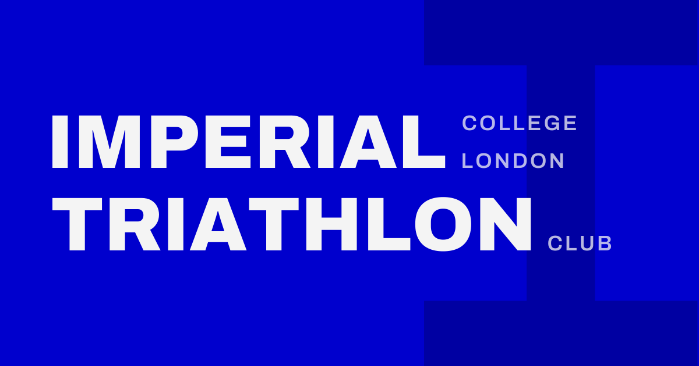

A university club doesn't strictly need a website. A good Instagram page and a group chat will get you surprisingly far. We built one anyway, for three reasons.

First, it puts the basics in one place: what we offer, when and where we train, how to join. That is what freshers look for. Second, alumni and potential sponsors get a clear picture of who we are without having to scroll through a feed. Third, and maybe most important, a website forces the club to decide how it wants to present itself. That decision is worth making, because it strengthens the club's identity from the inside as well.

How a club looks to the outside says a lot about how it sees itself. So this post explains what we were aiming for, and why the colours, typeface and logos look the way they do.

## The idea: serious, but not too serious

We take the club seriously. We don't take ourselves too seriously. ICTRI is a friendly club for everyone in the Imperial community, whatever their level: whether you have never swum a length of front crawl or you are chasing a BUCS podium.

The design should feel the same way: clear, confident and open, without looking like an elite performance programme or like a student society from another century.

## Visual identity

### Anchored in Imperial, built for triathlon

Imperial introduced a new visual identity in early 2024. It presents the university as modern, open and forward-looking. We think that fits triathlon well. Triathlon is a young sport that lives less on inherited tradition than, say, a boat club does.

The design therefore does two things. It picks up Imperial's look so that the university connection is obvious at first glance. And it uses a reduced, constructivist layout (flat colour, large type, strong grids) to connect with the aesthetics of modern triathlon.

### Colour

The main colour is **Imperial Blue**. It makes the connection to the university unmistakable, and we use it for the small accents: links, labels, session times, buttons and icons.

On phone screens, large areas in pure Imperial Blue can look a little too bright. That is why we added a second, **darker blue**. It is used for large surfaces such as the "Ready to tri?" band, for hover states and for the letter I in our profile picture. Together with a soft near-black and a cool off-white (our "silver"), that is the whole palette.

### Typeface

The typeface is [Archivo](https://fonts.google.com/specimen/Archivo), a free, open-source sans-serif. It is bold, fairly neutral and a little dynamic, and it comes with a wide range of widths and weights, so we can use one family for everything: headlines, body labels and logos.

### Logos

We deliberately kept the set small: one logo for the website, one for social media, and one social preview card.

**Website logo.** 
Simply "IC TRI", set in Archivo Italic. The italic slant gives it movement, and the short form works at small sizes in the navigation and the footer. It exists in white (for dark or photo backgrounds), in near-black (for light backgrounds) and shown on blue below.

**Profile picture.** 
The profile picture for social media takes up the blue. The large, darker-blue letter I in the background refers to the serifed I that runs through Imperial's own identity. It also makes the flat blue a bit more dynamic and quietly points to the university. In the foreground sits "TRI", set exactly like the website logo.

**No full "Imperial Triathlon" lockup.** We thought about a longer logo with the full club name and decided against it. We don't need it, because the short forms do the job, and it keeps us clear of the official university logo, which has its own rules.

### Social preview card

When a link to the website is shared, this is the card that appears. "IMPERIAL" and "TRIATHLON" lead; "College London" and "Club" support. It is set entirely in upright Archivo, on the same blue background with the big I behind it.

### Club kit

The two-blue idea also works for the trisuit and the cycling kit. The intense blue on top gives dynamism and identity. The navy below is more flattering. (Reference e.g. "Valence Triathlon Club")

## Quick reference

| | Value | Used for |
|---|---|---|
| Imperial Blue | `#0000CD` | Accents, links, labels, buttons, logo background |
| Dark blue | `#0000A2` | Large areas, hover states, the I in the profile picture |
| Near-black | `#161A1D` | Text, footer |
| Off-white / silver | `#F1F3F8` / `#F4F4F4` | Background areas / logo lettering |
| Navy (kit) | `#0A1038` | Lower part of the kit |

| | Setting |
|---|---|
| Typeface | Archivo (SIL Open Font License) |
| Website logo and "TRI" | Archivo Italic, weight 850, width 108, tracking +0.02 em |
| Headlines on the website | Archivo ExtraBold / Black, uppercase where used as a display |
| Social card | Archivo upright, weight 850 for "IMPERIAL" and "TRIATHLON", 600 for the small lines |

All logo files are plain SVGs with the lettering converted to outlines, so they look the same everywhere and need no font installed.
